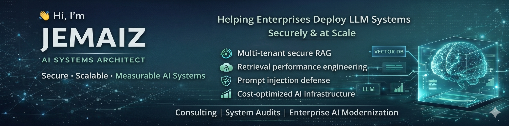

  

  

Zied Jemai — Architecte Data & IA · Toulouse

20 ans à structurer la donnée pour qu'elle soit exploitable : entrepôts de données et couches sémantiques en BI, gouvernance et qualité, et aujourd'hui bases de connaissances, RAG et LLM — avec une attention particulière à leur évaluation et à leur sécurisation.

Mentor et évaluateur de projets ML / IA chez OpenClassrooms.

Projets

automotive-knowledge-layer Couche sémantique et base de connaissances construites sur les mêmes données (rappels de sécurité NHTSA, 247 000 lignes) et reliées par un référentiel métier commun. Droits d'accès appliqués avant le classement, garde-fous contre l'injection de prompt, évaluation et tests de non-régression issus de défauts trouvés sur les données réelles. Python DuckDB SQL RAG Évaluation

Sportsee-RAG-Assistant Agent qui combine questions en langage naturel traduites en SQL et recherche documentaire, avec évaluation RAGAS intégrée à la CI et observabilité. LangChain Mistral FAISS Redis GitHub Actions

Domaines

Architecture data · Couches sémantiques · Bases de connaissances, RAG, LLM · Gouvernance et RGPD · Sécurité des applications IA

LinkedIn
